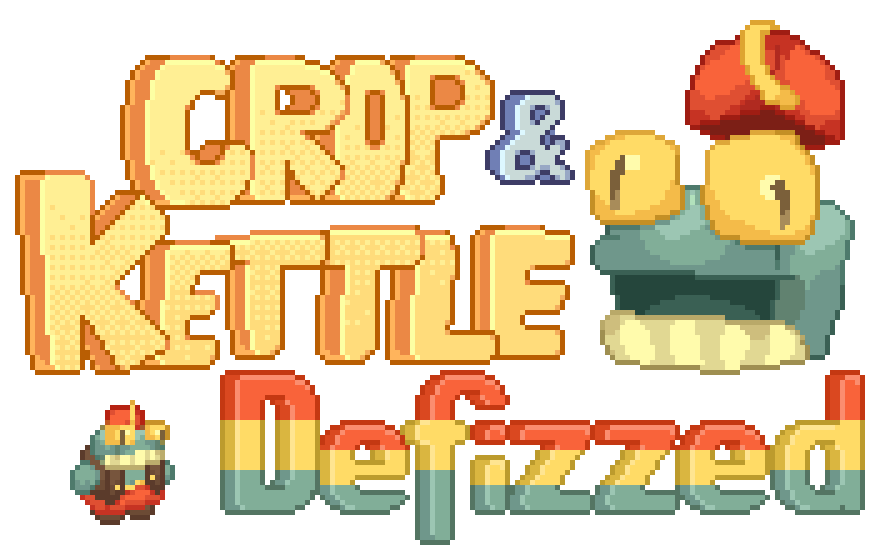

Defizzed is small addon for Crop and Kettle that adds Fizz's head.

Have you ever looked at that loveable, swamp-dwelling frog merchant and thought, "Wow, my taxedermy collection could really use a humanoid frog head"? No? Maybe? Well this pack can make those dreams come true! You too can kill a naturally spawing fizz and get its head and reanimate it with redstone and reflect on your actions and have fun!!!

Wait! That's not all! You can get an itty bitty fizz plush from fizz's signature lily pad parcels! They WILL silently judge you for your fizz head collection though.

HEY! This is an addon datapack! It will do nothing or break if Crop and Kettle ([Github Page](https://github.com/maybejake/crop-and-kettle) [Modrinth Page](https://modrinth.com/datapack/crop-and-kettle)), is not installed. Go install it!

## FAQ:
> Why aren't the textures working?
> 
BELOW the downloadable datapack file you can find the resource pack Make sure to add it to your resource pack folder and enable it. (If you are using the mod version, this doesn't apply to you.) (If you are using an older version before 1.0.0, the file acts as both the datapack and resource pack.)

> Will you port to version XYZ?
> 
It all depends, I most likely will not unless I have time! Plus, Crop and Kettle does not function before 1.21.6 and C&K 1.3 cannot be backported before 1.21.11.

> How do I get the head?
> 
The fizz head only drops from WILD fizz, any spawned with a whistle will not drop their head.

> How do I get the plush?
> 
The fizz plush can be gotten from lily pad parcels; open up a few and see what you can find!

---

Created By:
Stateus and Pan_Womsacz
